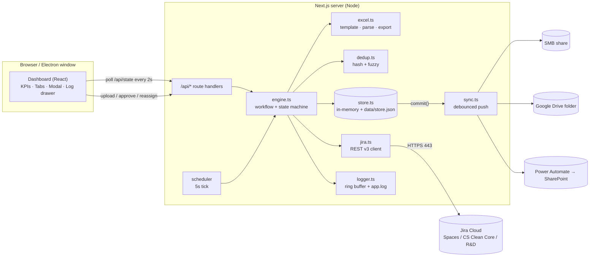
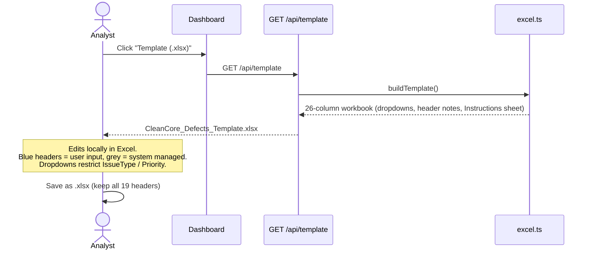
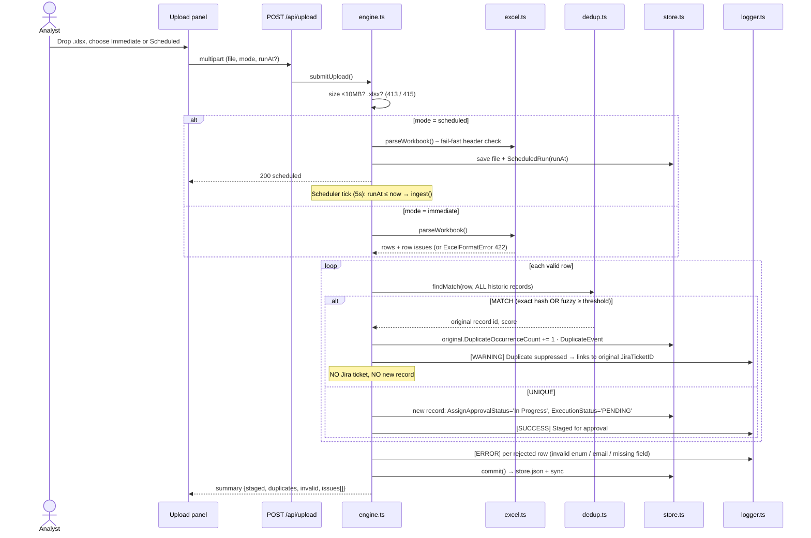
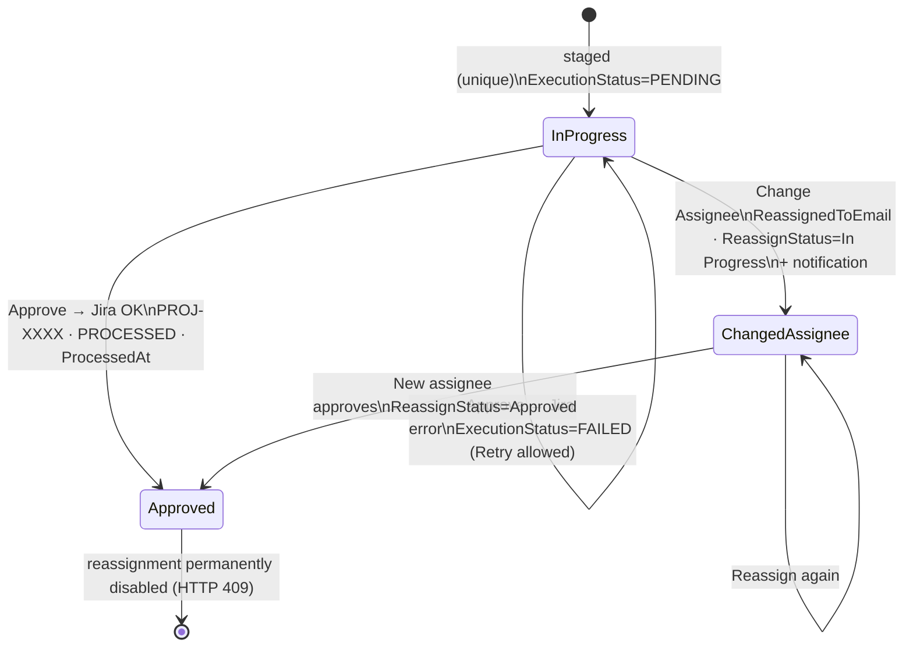
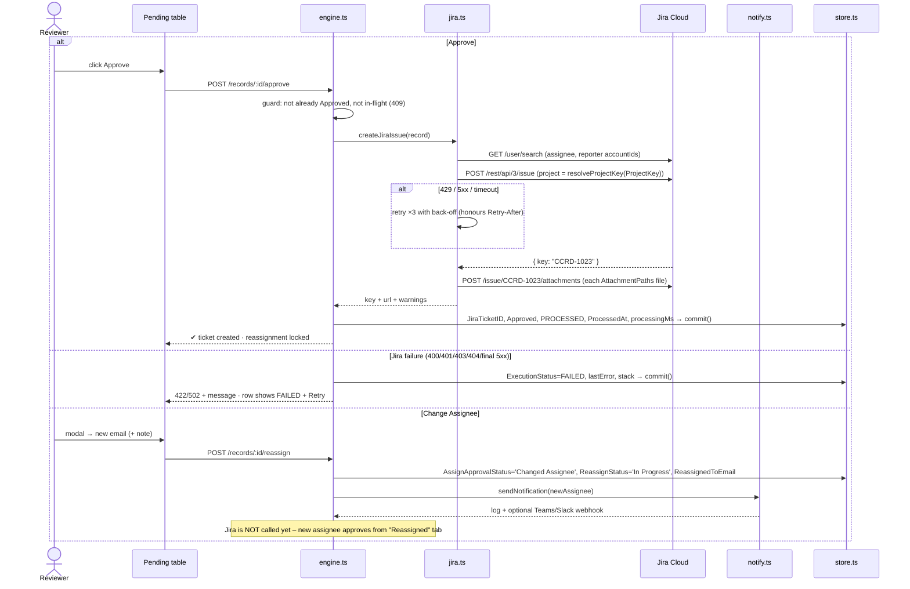
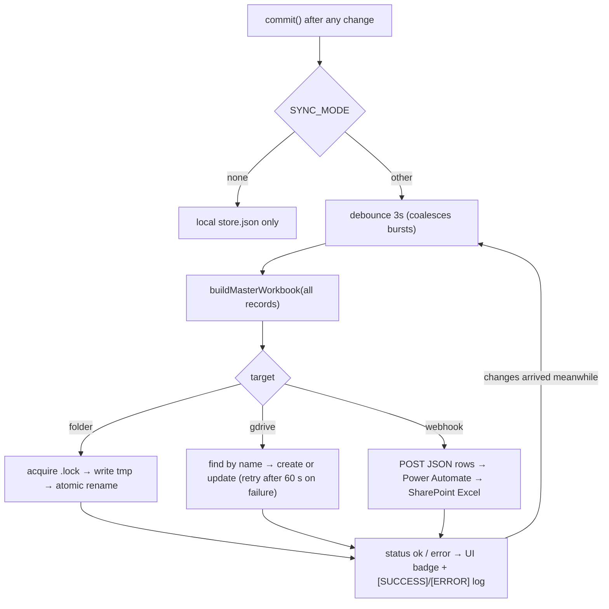

# 03 · End-to-End Architecture & Execution Flow

Mermaid diagrams render in GitHub, VS Code (Mermaid extension) and most wikis; an ASCII equivalent follows the system diagram.

## 1. System view



```
┌──────────────┐  2s poll   ┌────────────────────────── Next.js server ──────────────────────────┐
│  Dashboard   │──────────▶ │ /api/state ┐                                                         │
│  (React)     │  upload    │ /api/upload ├▶ engine.ts ─▶ excel.ts (parse/validate 19 cols)       │
│              │──────────▶ │ /api/records/:id/approve   ├▶ dedup.ts (hash → fuzzy)               │
│              │  approve   │ /api/records/:id/reassign  ├▶ store.ts (RAM + store.json) ──commit──▶ sync.ts ─▶ SMB | GitHub | Power Automate
│              │──────────▶ │                            ├▶ jira.ts ──HTTPS──▶ Jira Cloud         │
└──────────────┘            │ scheduler(5s) ─▶ engine    └▶ logger.ts ─▶ app.log + live drawer    │
                            └─────────────────────────────────────────────────────────────────────┘
```

## 2. Excel template download & local editing



## 3. Ingestion gateway → dedup → dual-state branching



Because staged rows are added to the history *during* the loop, duplicates **within the same file** are also caught.

## 4. Human-in-the-loop review





## 5. Background sync layer



Design rule: **`data/store.json` is the system of record; sync is a one-way push of a derived 26-column master workbook.** Nothing is edited in the synced copy (see doc 05 for what that means for each target).

## 6. Status transition table (authoritative)

| Event | AssignApprovalStatus | ExecutionStatus | ReassignStatus | JiraTicketID | ProcessedAt | DuplicateOccurrenceCount |
|---|---|---|---|---|---|---|
| Unique row ingested | `In Progress` | `PENDING` | `None` | – | – | 0 |
| Duplicate row ingested | *(unchanged on original)* | *(unchanged)* | *(unchanged)* | *(unchanged)* | – | **original +1** |
| Approve OK | `Approved` | `PROCESSED` | `None` (or `Approved` if it was reassigned) | `PROJ-XXXX` | ISO time | – |
| Approve fails | unchanged | `FAILED` | unchanged | – | – | – |
| Change Assignee | `Changed Assignee` | unchanged | `In Progress` | – | – | – |
| Approve after reassignment | `Approved` | `PROCESSED` | `Approved` | `PROJ-XXXX` | ISO time | – |
| Reassign after approval | **rejected – HTTP 409** | | | | | |
