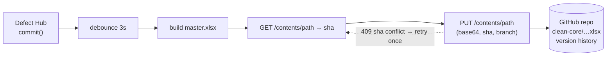
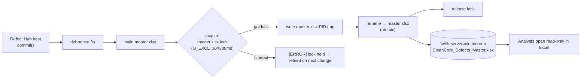
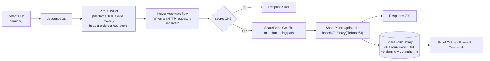

> **Update v2.4.0:** the GitHub option described below was **replaced by Google Drive** (`SYNC_MODE=gdrive`, see docs/09). This comparison is kept for the folder / webhook options and as history.

# 05 · Persistent Sync Mechanisms – Comparative Analysis

> **Revision note:** in `github` mode the sync layer is now a full **storage** layer (original uploads, attachments, per-upload tracking workbook, master, `state/store.json`, restore on a new machine) – see [09-GITHUB-STORAGE-SETUP](09-GITHUB-STORAGE-SETUP.md). `GITHUB_FILE_PATH` no longer exists; use `GITHUB_BASE_PATH`. The generic comparison below still applies for choosing a target.

**Context.** The app's system of record is `DATA_DIR/store.json`. After every committed change (debounced 3 s) `src/lib/sync.ts` pushes a derived **26-column master workbook** (`CleanCore_Defects_Master.xlsx`) to *one* target selected by `SYNC_MODE`. Push is one-way: the synced workbook is a **reporting/backup copy**, not an editing surface. (Edits made in the copy are not read back – by design, to avoid two writers on the approval state.)

Implemented and tested in this repo: `folder` (integration test, real file I/O), `webhook` (integration test against a local receiver), `github` (implemented to the GitHub Contents API contract; **not exercised against github.com** in the build environment – validate with a throw-away repo first).

---

## Option 1 · GitHub Repository Sync (Octokit / Git automation)



**Prerequisites**
- Private repo (e.g. `smartshift/cleancore-defect-data`), branch (`main` or a dedicated `data` branch to avoid triggering CI).
- **Fine-grained PAT** (or GitHub App installation token – preferred) scoped to that single repo: *Contents: Read and write*. Org SSO authorised.
- Outbound **HTTPS 443** to `api.github.com` (allow-list through the corporate proxy; set `HTTPS_PROXY`/`NODE_EXTRA_CA_CERTS` for TLS inspection).
- Branch protection must allow the token's identity to push (or push to an unprotected data branch).

**Configuration (`.env.local`)**
```ini
SYNC_MODE=github
GITHUB_TOKEN=github_pat_xxx
GITHUB_REPO=smartshift/cleancore-defect-data
GITHUB_BRANCH=data
GITHUB_FILE_PATH=clean-core/CleanCore_Defects_Master.xlsx
```

**Implementation** – built-in (`pushGithub()` in `src/lib/sync.ts`, plain `fetch`). Octokit equivalent if you prefer the SDK (`npm i @octokit/rest`):
```ts
import { Octokit } from "@octokit/rest";
const octo = new Octokit({ auth: process.env.GITHUB_TOKEN });
const [owner, repo] = process.env.GITHUB_REPO!.split("/");
const path = process.env.GITHUB_FILE_PATH!;
let sha: string | undefined;
try {
  const cur = await octo.repos.getContent({ owner, repo, path, ref: "data" });
  sha = (cur.data as { sha: string }).sha;
} catch (e: any) { if (e.status !== 404) throw e; }
await octo.repos.createOrUpdateFileContents({
  owner, repo, path, branch: "data", sha,
  message: `defect-hub sync ${new Date().toISOString()}`,
  content: (await buildMasterWorkbook(records)).toString("base64"),
});
```

**Trade-offs**

| Dimension | Assessment |
|---|---|
| Concurrency | Optimistic via blob SHA: a second writer gets **409**; we retry once. Fine for one app instance; multi-instance writers will thrash |
| File locking | None (and none needed for one writer). Binary `.xlsx` cannot be merged – a conflict means *last write wins* |
| Latency | 1–3 s per push; rate limit 5 000 req/h (≈1 push per 3 s sustained is safe); contents API file limit 100 MB (1 MB soft recommendation for API reads) |
| Security | Defect text (object names, dump details, customer-adjacent data) leaves the network perimeter into GitHub – needs InfoSec approval; token in env file; use a GitHub App + secret manager |
| Scalability | Repo grows with every binary revision (each push stores a full copy ⇒ 5 000-row xlsx ≈ 300 KB × thousands of commits). Mitigate with squashed data branch or push only on schedule |
| Maintenance | Low code, but token rotation (≤1 y for PATs), branch-protection drift |
| Strengths | Free immutable **audit history**, easy diff of *rows* if you also commit a CSV, works from anywhere |
| Weaknesses | Business users can't open it without GitHub access; binary diffs useless; noisy history |

---

## Option 2 · Local / Corporate Shared Drive Sync (SMB/CIFS, UNC path)



**Prerequisites**
- File share + folder (e.g. `\\fileserver\CleanCore\Defects`) with **Modify** for the service account running the app; users get **Read** only (so nobody holds the file open exclusively and blocks the rename).
- **TCP 445 (SMB)** open between app host and file server (VPN for remote laptops). SMB 3.x with signing/encryption.
- Windows host: use the UNC path directly; run the app/Electron as a user that can authenticate to it (or `net use Z: \\fileserver\CleanCore /persistent:yes`).
- Linux host: `sudo mount -t cifs //fileserver/CleanCore /mnt/cleancore -o credentials=/etc/cc.cred,uid=1000,vers=3.0,nobrl`.

**Configuration**
```ini
SYNC_MODE=folder
SYNC_FOLDER_PATH=\\fileserver\CleanCore\Defects      # Windows UNC (no quoting needed in .env)
# SYNC_FOLDER_PATH=/mnt/cleancore/Defects             # Linux mount
```

**Implementation** – built-in `pushFolder()` in `src/lib/sync.ts`: create-exclusive lock file (stale after 60 s), write to `*.tmp`, `rename` over the target, always release the lock. Verified by `tests/sync.test.ts` (leaves exactly one file behind).

**Trade-offs**

| Dimension | Assessment |
|---|---|
| Concurrency | Safe for N app instances *pushing* (lock + atomic rename). Readers never see a half-written file on a local FS; over SMB the rename is atomic on the server for same-share targets |
| File locking | Advisory lock file ours only. If an analyst has the master **open in Excel for editing**, Windows will refuse the rename → push fails with `[ERROR]`, auto-retries on the next change. Mitigation: read-only ACL for users or have them open a copy |
| Latency | Sub-second on LAN; seconds over VPN; **no API rate limits** |
| Security | Data stays on-prem; governed by existing AD/NTFS ACLs and backups; no external tokens |
| Scalability | Fine to tens of thousands of rows; limited by workbook rewrite time (~1 s per 5 k rows) |
| Maintenance | Lowest: no tokens, no licences. Watch for share permissions, drive-mapping per-user issues, VPN drops |
| Weaknesses | No built-in version history (rely on server snapshots/VSS); laptop-only desktop installs need line-of-sight to the share; mapped drive letters are per-session (use UNC) |

---

## Option 3 · Microsoft Power Automate + SharePoint / M365 (Excel Online)



**Prerequisites**
- M365 licence including **Power Automate premium** (the *HTTP request received* trigger is a premium connector) – or a per-flow plan.
- SharePoint site (e.g. *CS Clean Core R&D*) + document library with **versioning on**; a service account/connection owner with *Edit* on the library. Prefer a **service principal / shared connection owned by a service account**, not an individual.
- Outbound **HTTPS 443** to `*.logic.azure.com` / `prod-XX.<region>.logic.azure.com` (the HTTP-trigger URL contains a SAS-style signature `sig=` – treat as a secret). Optionally restrict the trigger to the app's egress IP (*Allowed inbound IP addresses* in the flow's settings).
- DLP policy in the Power Platform environment must allow *HTTP* + *SharePoint* in the same group.

**Configuration**
```ini
SYNC_MODE=webhook
POWER_AUTOMATE_URL=https://prod-12.westeurope.logic.azure.com:443/workflows/<id>/triggers/manual/paths/invoke?api-version=2016-06-01&sp=...&sig=...
POWER_AUTOMATE_SECRET=long-random-string
POWER_AUTOMATE_INCLUDE_ROWS=false     # true also sends rows[] (19 fields each) for flows that write to an Excel table
```

**Flow definition** (build in the designer; request-body schema for the trigger):
```json
{
  "type": "object",
  "properties": {
    "sentAt":     { "type": "string" },
    "count":      { "type": "integer" },
    "fileName":   { "type": "string" },
    "fileBase64": { "type": "string" },
    "rows":       { "type": "array", "items": { "type": "object" } }
  }
}
```
Steps: **(1) Condition** `@equals(triggerOutputs()?['headers']?['x-defect-hub-secret'], '<secret>')` → *No*: Response 401. **(2) Get file metadata using path** `/Shared Documents/CS Clean Core/R&D/CleanCore_Defects_Master.xlsx` (first run: use *Create file* instead). **(3) Update file** – *File Identifier* = Id from (2), *File Content* = `@base64ToBinary(triggerBody()?['fileBase64'])`. **(4) Response** 200. Set trigger **Settings → Concurrency control → ON, degree 1** so pushes are applied in order.

Variant for live Excel *tables* (no file overwrite): enable `POWER_AUTOMATE_INCLUDE_ROWS`, then in the flow call **Run script** (Excel Online Business) with this Office Script (clears and rewrites the `Defects` sheet from `rows`):
```ts
function main(workbook: ExcelScript.Workbook, rowsJson: string) {
  const H = ["ProjectKey","IssueType","Summary","Description","Lead","Priority","AssignApprovalStatus","AssigneeEmail","ReporterEmail",
    "Components","Labels","AttachmentPaths","JiraTicketID","ExecutionStatus","ProcessedAt","DuplicateOccurrenceCount","ReassignedToEmail","ReassignStatus"];
  const rows = JSON.parse(rowsJson) as Record<string, string | number>[];
  const ws = workbook.getWorksheet("Defects") ?? workbook.addWorksheet("Defects");
  ws.getUsedRange()?.clear();
  const data = [H, ...rows.map((r) => H.map((h) => r[h] ?? ""))];
  ws.getRangeByIndexes(0, 0, data.length, H.length).setValues(data);
}
```
(Office Scripts need a business licence with Office Scripts enabled; check your tenant's action-payload limits before sending thousands of rows – the file-overwrite variant above has no row limit.)

**Trade-offs**

| Dimension | Assessment |
|---|---|
| Concurrency | Flow concurrency = 1 serialises writes; SharePoint **co-authoring** lets many people view the file while it is replaced (an *Update file* on a file open in Excel Online succeeds; desktop Excel users get a "file updated" prompt) |
| File locking | SharePoint handles locks/check-out; if someone has it *checked out* the update fails → flow run shows *Failed*; our app logs `[ERROR] Power Automate HTTP 4xx/5xx` and retries on the next change |
| Latency | 2–15 s (flow cold start + SharePoint). Throttles: ~100 000 actions/day per user on typical plans; SharePoint ~600 calls/min/connection – irrelevant at this volume |
| Security | Entra ID/M365 identity, DLP, retention labels, sensitivity labels, audit log – **best governance**. Secrets: SAS URL + shared header secret (rotate; IP-restrict) |
| Scalability | SharePoint file ≤ 250 MB; Excel Online comfortable to ~100 k rows; payload of the HTTP trigger ≤ 100 MB (base64 inflates ×1.33) |
| Maintenance | Medium: licence, flow ownership (orphaned flows when the owner leaves), connection re-auth, DLP changes. Needs a Power Platform admin |
| Strengths | Users already live in M365/Teams; versioning + restore; Power BI on top; no inbound network path to the app host |

---

## Side-by-side

| Criterion (weight) | GitHub | SMB shared drive | Power Automate + SharePoint |
|---|:-:|:-:|:-:|
| Time-to-value / setup effort (15%) | 3 | **5** | 2 |
| Latency (10%) | 3 | **5** | 2 |
| Concurrency & integrity of the file (15%) | 3 | 4 | **5** |
| Version history / audit (15%) | **5** | 2 | **5** |
| Security & compliance fit (20%) | 2 | 4 | **5** |
| Accessibility to business users (10%) | 1 | 4 | **5** |
| Ops / maintenance burden (10%) | 3 | **5** | 3 |
| Scales to remote/hybrid teams (5%) | 4 | 2 | **5** |
| **Weighted score (/5)** | **3.0** | **3.9** | **4.2** |

*(Scores are my judgement for a typical SAP services organisation on M365 and Jira Cloud; re-weight to your own priorities.)*

## Efficiency verdict for SAP Clean Core & S/4HANA migration teams

1. **Production recommendation – Option 3 (Power Automate + SharePoint).** These teams already collaborate in Teams/SharePoint, defect data is client-sensitive (custom-code object names, dump content) and needs retention/DLP/audit controls, and many consultants work remotely off-VPN. SharePoint gives versioning and restore for free and removes any inbound path to the app host.
2. **Pilot / single-site or air-gapped programmes – Option 2 (shared drive).** Fastest to stand up (one env var), lowest latency, zero licences and nothing leaves the network. Treat it as phase 1 and migrate by flipping `SYNC_MODE` – the master workbook format is identical.
3. **Option 1 (GitHub) – only as a secondary audit archive** (e.g. nightly scheduled push to a restricted data branch). Binary spreadsheets are a poor fit for Git and sending client defect data to an external SaaS usually needs explicit approval.

Whichever you choose, keep Jira as the operational source of truth for ticket state, and keep `store.json` backed up (it holds approval state and duplicate counts that the master file is derived from).
